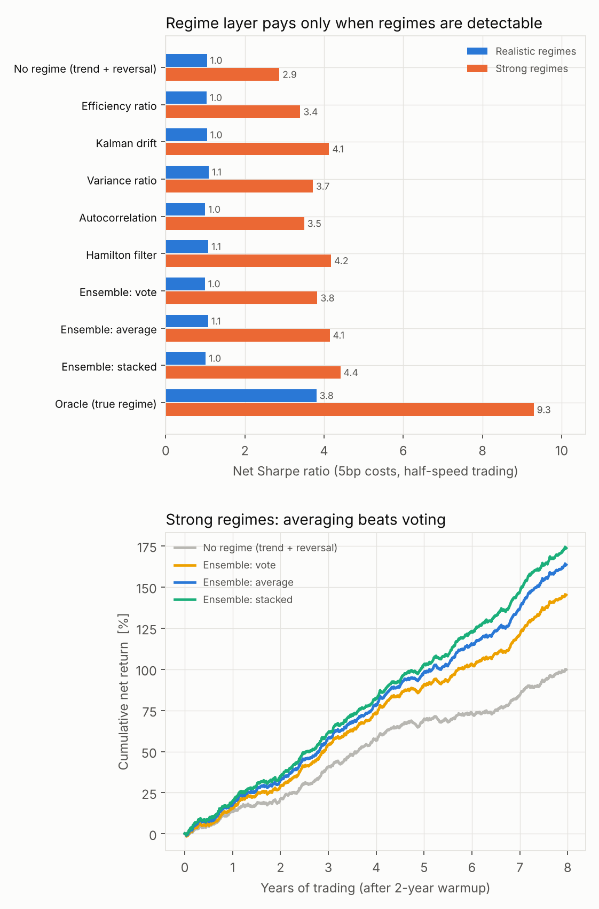

# VolHarvesting

Research pipeline for a **regime-switching long/short equity strategy**: in trending regimes it follows residual trends, in mean-reverting regimes it harvests volatility by fading recent moves. Several regime-detection methods are combined (vote, average or stacked), and the portfolio is kept **beta- and sector-neutral**.

The background:
- Trend following earns ½(net move² − realized variance).
- Rebalancing earns the reverse, to second order: rebalancing − buy-and-hold ≈ −f(1−f) × trend P&L.
- So the value of switching between them depends entirely on how well the regime is called. See `docs/REPORT.md` for results.



## Layout

```
data/                 input data (not committed); formats in data/README.md
src/volharvest/
  config.py           all parameters: universe, model, portfolio
  universe.py         synthetic universe with known regimes; CSV loader for real prices
  factors.py          rolling beta, market + sector residuals, rolling vol
  regimes.py          regime scores: variance ratio, efficiency ratio, autocorrelation, Hamilton filter, Kalman drift
  ensemble.py         weekly feature panel; walk-forward ridge (single / vote / average / stacked / oracle)
  portfolio.py        closed-form mean-variance weights, exact beta + sector neutrality, caps via Dykstra projection
  backtest.py         weekly backtest with costs; Sharpe, turnover, realized beta, factor R²
  run.py              end-to-end CLI
  charts.py           summary chart
scripts/              single-asset studies behind the design (mirror identity, regime-accuracy sweep)
tests/                neutrality, caps, and no-look-ahead tests
docs/REPORT.md        method, results and caveats
```

## Quick start

```bash
pip install -r requirements.txt
pip install -e .                 # or: export PYTHONPATH=src

pytest
python -m volharvest.run --scenario realistic --trade-fraction 0.5 --out output/realistic_tf0.5
python -m volharvest.run --scenario strong    --trade-fraction 0.5 --out output/strong_tf0.5
python -m volharvest.charts
```

Each run prints a table (gross and net Sharpe, IC, turnover, realized beta, factor R², regime AUC) and writes `results.json` and `curves.npz` to its output folder.

## Real data

Put `prices.csv` and `sectors.csv` in `data/` (formats in `data/README.md`), then:

```bash
python -m volharvest.run --prices data/prices.csv --sectors data/sectors.csv --trade-fraction 0.5 --out output/real
```

True regimes are unknown on real data, so judge each method by its out-of-sample Sharpe and IC improvement over the `no_regime` baseline, and test the best variant for data snooping.

## Headline result (synthetic)

| Net Sharpe | Realistic signals | Strong signals |
|---|---|---|
| No regime | 1.04 | 2.87 |
| Ensemble: vote | 0.99 | 3.83 |
| Ensemble: average | 1.07 | 4.14 |
| Ensemble: stacked | 1.01 | 4.41 |
| Oracle (true regime) | 3.81 | 9.30 |

At realistic signal strength the regime layer adds nothing; when regimes are detectable, averaging beats voting and stacking is best. Absolute Sharpe ratios are inflated by the clean synthetic setup.
