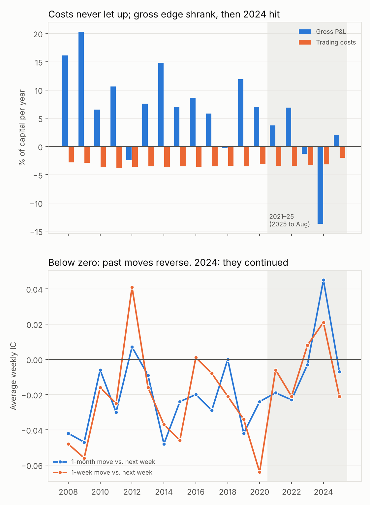

# Real-data study: 88 US large caps, 2005–2025


## Bottom line

On real prices, **the regime layer does not help.** No regime method or ensemble beats the simple no-regime model (a fixed blend of residual trend and reversal), and the stacked ensemble is significantly worse. The base strategy itself is thin: a gross Sharpe of 0.80 becomes 0.32 after 5bp costs, and it has been in a drawdown since May 2021 that was still at its low in August 2025.

## Data and setup

- **Prices:** daily adjusted closes, 25 Aug 2005 – 22 Aug 2025. The final row (25 Aug 2025) was dropped as an apparent intraday snapshot.
- **Universe:** 88 stocks. GOOG was dropped as a near-duplicate of GOOGL (daily return correlation 0.997). The sector ETFs and indices are not traded.
- **Sectors:** GICS (2025), with small groups merged: Linde into "Industrials & Materials"; utilities with real estate. See `data/sectors.csv`.
- **Market proxy:** S&P 500 index (`^GSPC`).
- **Portfolio:** weekly rebalance, half of the gap to target traded each week, 10% ex-ante volatility target, 5% per-name cap, exactly beta- and sector-neutral at each rebalance.
- **Trading period:** Sep 2007 – Aug 2025, after a 2-year warmup. Forecasts are refit yearly on an expanding window, so every result is out of sample.
- **Data checks:** no gaps or non-positive prices. GE's 2023 and 2024 spin-offs are correctly adjusted. The largest unexplained daily moves (VRTX, AMD, NFLX, C, CDNS, NVDA) are genuine events, not bad prints.

Reproduce with:

```bash
python -m volharvest.run --prices data/prices.csv --sectors data/sectors.csv --market ^GSPC \
    --drop-last-row --trade-fraction 0.5 --max-weight 0.05 --out output/real_tf0.5
python scripts/real_data_study.py --prices data/prices.csv --sectors data/sectors.csv
python scripts/real_data_charts.py
```

## Results

**Headline (5bp one-way costs):**

| Variant | Gross Sharpe | Net Sharpe | Net return / yr | Volatility | Gross leverage | Turnover / week |
|---|---|---|---|---|---|---|
| Trend only | 0.57 | 0.25 | 2.1% | 8.4% | 2.3× | 1.07 |
| Reversal only | 1.00 | 0.31 | 1.8% | 5.7% | 1.5× | 1.56 |
| **No regime** | **0.80** | **0.32** | **2.3%** | **7.2%** | **1.9×** | **1.35** |
| Hamilton filter | 0.75 | 0.28 | 2.0% | 7.1% | 1.8× | 1.32 |
| Kalman drift | 0.79 | 0.32 | 2.2% | 6.9% | 1.7× | 1.29 |
| Ensemble: vote | 0.78 | 0.31 | 2.1% | 6.8% | 1.7× | 1.29 |
| Ensemble: average | 0.77 | 0.29 | 2.0% | 6.9% | 1.7× | 1.29 |
| Ensemble: stacked | 0.67 | 0.19 | 1.2% | 6.5% | 1.7× | 1.25 |

Realized volatility (about 7%) is below the 10% target because the 5% per-name cap binds.

**Cost sensitivity (net Sharpe):**

| Variant | 0bp | 2bp | 5bp | 10bp |
|---|---|---|---|---|
| No regime | 0.80 | 0.61 | 0.32 | −0.14 |
| Ensemble: average | 0.77 | 0.58 | 0.29 | −0.18 |
| Ensemble: stacked | 0.67 | 0.48 | 0.19 | −0.29 |

The strategy breaks even at roughly 8bp one-way. Costs, not signal, decide whether it is worth running.

**Significance versus no regime** (net Sharpe difference at 5bp; 20-day block bootstrap, 2,000 resamples):

| Variant | Difference | 95% interval | p (better than baseline) |
|---|---|---|---|
| Kalman drift | −0.006 | −0.06 to +0.05 | 0.58 |
| Ensemble: vote | −0.019 | −0.08 to +0.04 | 0.73 |
| Efficiency ratio | −0.026 | −0.06 to +0.01 | 0.91 |
| Ensemble: average | −0.031 | −0.09 to +0.02 | 0.88 |
| Hamilton filter | −0.040 | −0.08 to 0.00 | 0.96 |
| Variance ratio | −0.042 | −0.09 to 0.00 | 0.97 |
| Autocorrelation | −0.045 | −0.12 to +0.03 | 0.88 |
| Ensemble: stacked | −0.136 | −0.25 to −0.01 | 0.99 |

Every regime variant is at or below the baseline. Stacking is reliably worse: its fitted weights overfit noise, which is the failure mode the synthetic study predicted for weak regimes.

**Net Sharpe by subperiod (5bp):**

| Variant | 2007–09 | 2010–14 | 2015–19 | 2020–22 | 2023–25 |
|---|---|---|---|---|---|
| Trend only | 0.34 | 0.54 | 0.74 | 0.26 | −0.83 |
| Reversal only | 1.55 | 0.53 | 0.26 | 0.34 | −1.10 |
| No regime | 1.02 | 0.75 | 0.56 | 0.26 | −1.01 |
| Ensemble: average | 0.93 | 0.68 | 0.54 | 0.25 | −0.96 |

The edge decays over time and turns clearly negative from 2023. The no-regime model peaked in May 2021 and was in August 2025 was 28.7 percentage points of cumulative return below that peak, about four times its annual volatility, with no recovery yet.

## Why the strategy has been in drawdown since May 2021



From the May 2021 peak to August 2025, the no-regime model lost 25.2% of capital net: **14.1% from trading costs and 11.1% from gross losses**. Four findings explain it (`scripts/drawdown_analysis.py`):

1. **The strategy was never a trend follower.** At every yearly refit, the model's weight on the one-month "trend" signal is negative (−0.006 to −0.031), as is its weight on the one-week signal. On these stocks, both past moves have mostly predicted *reversals* (negative IC in most years), so the walk-forward fit learned to fade both. The "trend only" row in the tables above is therefore a one-month reversal strategy. In practice the whole system is a short-horizon contrarian strategy: it sells recent residual winners and buys recent residual losers.
2. **In 2024, reversal turned into continuation.** Both signals' ICs turned positive in 2024 (one-month +0.045, t ≈ 1.7; one-week +0.021), the strongest continuation in the sample. A contrarian book lost 13.7% gross that year, its worst year, more than the whole drawdown's gross loss.
3. **The losses came from fading a handful of persistent winners.** Since the peak, the ten worst stocks lost 26.6% while the rest of the book made 15.4%. The model was short each of the top losers most of the time: NVDA (−6.0%, short on 68% of days while it rose about 1,000%), GE (−3.7%), NFLX (−2.9%), COST (−2.5%), APH (−2.1%), ORCL (−2.0%) and LLY (−1.7%).
4. **Costs turned a shrinking edge into a loss.** Costs ran a steady 3.2–3.4% a year. Gross P&L fell from an average of about 9% a year in 2008–2019 to 3.7% in 2021 and 6.9% in 2022, then −1.3% in 2023: barely enough to cover costs even before 2024.

What it was **not**:

- **Not a lack of opportunity.** Cross-sectional dispersion of weekly residual returns was normal (2.5–3.1% in 2021–25, versus 2.1–2.7% in 2010–2019).
- **Not a broad factor bet.** Regressing daily P&L on the market, a momentum factor and a mega-cap factor explains only about 6% of variance before and after the peak, and the factor contributions roughly cancel since the peak: market +4.7%, momentum −1.0%, mega-cap −3.7%. The strategy is structurally short momentum (beta −0.09) and mega-caps (−0.06), but the losses were in specific stocks, not those factors.

Regime detection should, in principle, have caught 2024's switch to continuation and flipped the book. None of the five methods detected it early or reliably enough to change positioning.

## Survivorship bias

Every stock trades for the full 20 years, so the list is today's largest companies, chosen with hindsight.

- **The biggest winners didn't flatter the results.** Removing the 10 largest full-sample compounders (NVDA, NFLX, BKNG, AAPL, AMZN, REGN, CRM, APH, LRCX, INTU) *raised* net Sharpe: no regime from 0.32 to 0.46, trend only from 0.25 to 0.47. The strategy lost money on those names.
- **The missing failures probably do flatter it.** Companies that collapsed or were acquired (for example, in 2008) are absent. The reversal leg buys recent losers; in a point-in-time universe, some of those losers would have kept falling. Expect real results to be somewhat worse than shown.

## Factor exposure

The portfolio is exactly beta- and sector-neutral at each rebalance using estimated betas, but realized exposure leaks: realized beta of about 0.06, and market plus sector returns explain about 6% of P&L variance (versus at most 0.5% in the synthetic study). Betas estimated from one year of daily data are noisy for volatile names.

## Recommendations

1. **Don't trade this as is.** The regime layer adds no value here, and the base signal has been losing since 2021.
2. **If continuing the research:**
   - test on a broad, point-in-time universe (e.g. historical S&P 500 or Russell 1000 membership, with delisted stocks), since 88 names gives little breadth;
   - cut turnover (longer holding periods, a turnover penalty), because costs consume about 60% of gross return;
   - neutralize momentum and size, and exclude names around earnings;
   - shrink betas toward 1 or estimate them on weekly data to reduce beta leakage;
   - add a genuine slower trend signal (e.g. 6–12 month residual momentum), since the current one-month "trend" signal is traded as a reversal and the system has no way to profit from persistent winners like those of 2024.
3. **Simplest robust choice:** if regime information is used at all, use the plain average, never stacking.
